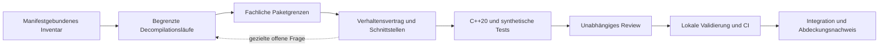

# Rekonstruktion in begrenzten Arbeitspaketen

Dieser Workflow führt vom statisch untersuchten Original zu einer eigenständigen
C++20/CMake-Implementierung für Windows und Linux. Vollständiger Export,
verstandenes Verhalten und bestätigte Spielparität sind verschiedene Nachweise.
Unbekannte Ergebnisse zählen niemals als Erfolg. Das Spiel ist derzeit nicht
spielbar.

## Stand und maßgebliche Quellen

GitHub Issues in [Kevni92/opr2](https://github.com/Kevni92/opr2/issues) enthalten
die Arbeitspakete, ihre konkreten Grenzen, Abhängigkeiten und Abnahmekriterien.
Dieses Dokument beschreibt den gemeinsamen Prozess; es ist kein zweites Backlog.
[Issue #22](https://github.com/Kevni92/opr2/issues/22) dokumentiert die Einrichtung.
`automation/workflow.json` ist die deklarative Spezifikation dieses Prozesses.
Sie wird vom bisherigen Python-Runner noch nicht eingelesen.

Heute ausführbar ist `tools/orchestrator.py plan|run --issue N`: ein generischer
Worker, ein separater Reviewer und die bestehenden Integrationsgates. Native
Codex-Spezialagenten liegen unter `.codex/agents/`. Der CLI-Adapter lädt ihre
Rolleninstruktionen noch nicht ausdrücklich. Queue, Rollendispatch, persistente
Wiederaufnahme und automatische Erzeugung konkreter Folgeissues sind
Implementierungsaufträge im verlinkten Backlog, keine vorhandenen Funktionen.
Es werden in dieser Einrichtung keine Originale analysiert oder Spielsysteme
implementiert.

## Pipeline

Der erste Decompilationsbestand ist eine versionierte Momentaufnahme. Neue
Erkenntnisse können eine gezielte erneute Untersuchung verlangen. Ein Export
aller erkannten Funktionen beweist weder, dass alle Funktionen erkannt wurden,
noch dass alle indirekten Aufrufe oder Datentypen geklärt sind.

| Stufe | Ein begrenztes Paket liefert | Voraussetzung für die nächste Stufe |
|---|---|---|
| `inventory` | Eine festgelegte Inventarseite oder eine eng begrenzte Abhängigkeitsfrage; private Identitäten und selbst formulierte Kurznotiz | Manifestidentität bestätigt, Umfang und Lücken festgehalten |
| `decompile` | Ergebnisse für eine vorab festgelegte endliche Funktionsmenge; pro Funktion Erfolg, Fehler oder ungeklärt | Kein stilles Auslassen; relevante Aufrufe und Datenbezüge zugeordnet oder als offen markiert |
| `partition` | Eine belegte fachliche Grenze mit Abhängigkeiten und gemeinsam verwendeten Daten | Zuständigkeit, Import-/Exportschnittstellen und ungelöste Grenzfragen dokumentiert |
| `specify` | Ein Verhaltensvertrag für genau eine Operation oder einen kleinen Zustandsübergang | Eingaben, Ergebnisse, Zustandsänderungen, Zahlenregeln, Fehlerfälle und Testorakel ausreichend belegt |
| `implement` | Eine kleine C++20-Änderung für diesen Vertrag | Synthetische Tests vorhanden; keine ungeprüften Regeln ergänzt |
| `test` | Unabhängig formulierte synthetische Testfälle für einen bestehenden Vertrag | Aussagekräftige Erwartungen und negative Fälle; keine aus Originaldaten kopierten Fixtures |
| `validate` | Nach unabhängigem Review erzeugte lokale Prüfergebnisse für genau Head, Basis und Umgebung | Alle erforderlichen Prüfungen erfolgreich und aktuell |
| `integrate` | Geprüfter PR und aktualisierte knappe Abdeckungsangabe | Unveränderte geprüfte Commits, grüne CI, Originalintegrität falls erforderlich |

Inventar- und Exportbatches begrenzen technische Arbeit. Fachliche Pakete werden
erst aus Zusammenhängen abgeleitet. Eine Funktion kann mehreren Systemen dienen;
sie erhält eine zuständige Implementierung und dokumentierte Nutzer. Compiler-
und Bibliothekscode wird gesondert klassifiziert und bei belegter Eignung durch
Standard- oder Projektfunktionen ersetzt. Original-DLLs sind keine Laufzeitlösung.
Falls die EXE relevante Logik an weitere Originalmodule delegiert, entsteht
zunächst eine eigene manifestgebundene Analyseaufgabe. Die aktuelle REA-
Zielbindung an `PR2.exe` darf ein Worker dafür nicht selbst erweitern.

## Rollen

| Codex-Agent | Modell | Aufgabe |
|---|---|---|
| `opr2_orchestrator` | `gpt-6-sol`, low | Freigegebene Issues auswählen, klein zerlegen, passende Luna-Rolle beauftragen, Gates und Übergaben koordinieren |
| `opr2_planner` | `gpt-6-luna` | Aus bestätigten Erkenntnissen konkrete, begrenzte Issue-Entwürfe erstellen |
| `opr2_inventory` | `gpt-6-luna` | Zielidentität, Funktionsinventar oder eine konkrete Abhängigkeitsfrage statisch prüfen |
| `opr2_decompiler` | `gpt-6-luna` | Genau den zugewiesenen Decompilationsbatch mit Ergebnisstatus bearbeiten |
| `opr2_partitioner` | `gpt-6-luna` | Eine belegte Paketgrenze und ihre Schnittstellen untersuchen |
| `opr2_specifier` | `gpt-6-luna` | Einen nachvollziehbaren Verhaltensvertrag aus begrenzten Befunden verfassen |
| `opr2_cpp` | `gpt-6-luna` | Genau einen freigegebenen Vertrag in C++20 umsetzen |
| `opr2_test_author` | `gpt-6-luna` | Synthetische Testfälle unabhängig vom Implementierungsdetail verfassen |
| `opr2_reviewer` | `gpt-6-luna` | Den exakten Commit unabhängig auf Vertrag, Richtigkeit und Datenschutz prüfen |
| `opr2_validator` | `gpt-6-luna` | Nur ausdrücklich übergebene Prüfungen nach Commit-Review durchführen und Ergebnisse einordnen |
| `opr2_worker` | `gpt-6-luna` | Kompatible allgemeine Worker-Rolle für bestehende kleine Issues |

Reviewer, Validator und Koordinator sind Phasenrollen, keine normalen
vor Review gestarteten Worker. Nur `worker_roles` aus
`automation/workflow.json` dürfen als Worker-Routing gewählt werden. Eine
Validierungsaufgabe, die ausschließlich private Prüfergebnisse erzeugt, wird
nach Freigabe des zu prüfenden Commits ausgeführt und darf nicht in den
bisherigen Worker-Pfad mit seiner Pflicht zu einem nichtleeren Diff geraten.
`validate` und `integrate` sind entsprechend nachgelagerte Prozessphasen.

Der Python-Runner benötigt kein Koordinatormodell. Sol wird für begrenzte
Koordinationsentscheidungen eingesetzt, nicht für massenhafte Decompilation,
Implementierung oder Wiederholung bereits vorhandener Befunde. Eine fehlende
Rolle, ein Providerfehler oder ein unerreichbares Modell führt zur Blockade,
niemals zu einem stillen Modellwechsel. Die ausdrücklich erlaubte Sol-Ausnahme
gilt ausschließlich für Koordination; weitere teurere Rollen brauchen eine
ausdrückliche Wahl des Nutzers.

## Vertrag eines Arbeitspakets

Jedes ausführbare kleine Issue enthält genau einen JSON-Vertrag gemäß
[docs/workflow.md](workflow.md), ohne neue Schemafelder. Routing-Metadaten
stehen außerhalb des JSON in einer Tabelle:

| Feld | Bedeutung |
|---|---|
| `Stage` | Eine Stufe aus der Pipeline oder `bootstrap` |
| `Role` | Genau eine Rolle aus der Rollentabelle; bei `Lane: maintainer` der reservierte Wert `maintainer` |
| `Lane` | `worker` für den bestehenden Runner oder `maintainer` für geschützte Infrastruktur |
| `Parent` | Das übergeordnete GitHub Issue |
| `Package` | Stabile fachliche Kennung; konkrete private Funktionsselektoren bleiben lokal |
| `Budget` | Höchstzahl der Einheiten, Aufrufe und Versuche; klare Abbruchgrenze |

Das Issue nennt genau ein Ergebnis, den eingeschlossenen Umfang, ausgeschlossene
Nachbaraufgaben, Literalpfade, geschlossene Voraussetzungen und überprüfbare
Abnahmekriterien. Bei Analysepaketen enthält es nur eine unabhängig formulierte
Frage; Originalpfade, Adresslisten, Pseudocode, Manifeste und Evidence-Dumps
werden nicht veröffentlicht. Der Koordinator liefert dem Worker stattdessen
einen absoluten privaten Eingabepfad und Ausgabeordner unter Root `analysis/`.
Ein erfolgreicher rein privater Export benötigt zusätzlich eine kleine
veröffentlichbare Ergebnisnotiz im erlaubten Dokumentationspfad, da der aktuelle
Runner einen nichtleeren Diff erwartet.

Eine Aufgabe wird geteilt, wenn sie mehrere unabhängig lieferbare Ergebnisse,
unterschiedliche Rollen, unklare Schnittstellen oder mehr Kontext als das
vereinbarte Budget verlangt. Ein Epic ist ein Container und wird nie als Ganzes
an einen Worker delegiert. Unbekannte Spielregeln erzeugen Analysefragen;
Implementierungsissues entstehen erst nach ausreichender Spezifikation.
Testentwurf darf ein eigenes Paket sein, wenn der Vertrag unabhängig prüfbar ist;
die Implementierung liefert trotzdem die für ihre Abnahme notwendigen Tests.

## Freigabe und autonome Folgepakete

Eine Maintainer-Freigabe mittels `agent:ready` bleibt Voraussetzung für `run`.
Die Einrichtung dieses Workflows erteilt keine Freigabe zum Start der neuen
Analyse- oder Implementierungsissues. Alle jetzt angelegten Folgepakete bleiben
ungekennzeichnet als ready.

Für spätere größtenteils autonome Läufe kann ein Maintainer eine begrenzte
Paketfamilie freigeben: Elternissue, erlaubte Rollen und Pfade, konkrete private
Inventaridentität, endliche Einheitenliste, Gesamtbudget und Abbruchregeln. Ein
künftiger Queue-Dispatcher darf daraus deterministisch konkrete Kinder bilden,
wenn eine umgesetzte und geprüfte Grant-Prüfung die Grenzen nachweist. Ein
Modelltext allein erteilt keine Freigabe. Erweiterungen der Familie, neue
Schreibpfade, Originalausführung, geänderte Schutzregeln oder Modellwechsel
bleiben außerhalb dieses Grants. Ohne implementierte Grant-Prüfung setzt
ausschließlich ein Maintainer jedes Kind auf `agent:ready`.

## Übergabe, Prüfung und Integration

1. Der Koordinator liest nur Issue-Vertrag, Routing, Freigabe und den knappen
   aktuellen Status. Er prüft geschlossene Abhängigkeiten und die private
   Zielidentität. Das Issue und sein Vertrag werden für den Lauf identifiziert;
   Änderungen am Auftrag erfordern eine neue Freigabe und neue Nachweise.
2. Genau eine Worker-Sitzung erhält Rolle, Literalpfade, Basiscommit,
   Abnahmekriterien, relevante Dateiausschnitte und begrenzte private Befunde.
   Kein vollständiger Elterntranskript und kein pauschaler Gesamtexport.
3. Der Worker ändert nur zugewiesene Pfade. Rohbefunde gehen ausschließlich in
   den vom Koordinator erlaubten absoluten privaten Ausgabeordner. Die Antwort
   entspricht `automation/worker-result.schema.json`; `tests` nennt vor Review
   ausschließlich geplante Befehle mit Kennzeichnung `NOT RUN`.
4. Der Koordinator prüft Diff, Scope und Guards und erstellt den lokalen
   `#NUMMER ...`-Commit. Eine separate Luna-Sitzung prüft genau diesen Commit.
   REA-Reviewer erhalten weder Originalzugriff noch einen REA-Server, sondern
   nur den begrenzten kanonischen Evidenzauszug und die Ergebnisnotiz. Fehlende
   oder gekürzte Evidenz bleibt unbekannt. Ergebnisformat:
   `automation/review-result.schema.json`.
5. Erst nach unabhängiger Freigabe führt der deterministische Runner die
   erforderlichen lokalen Prüfungen aus. `opr2_validator` ist nur für einen
   ausdrücklich beauftragten Prüfauftrag vorgesehen und ersetzt kein Gate.
   Projektprogramme verwenden Originaldaten ausschließlich als Wegwerfkopien
   unter `analysis/`. Originalprogramme werden niemals gestartet.
6. Der Koordinator veröffentlicht nur selbst formulierte knappe Ergebnisse und
   Projektcode, erstellt den PR und lässt vorhandene CI arbeiten. Merge erfolgt
   ausschließlich mit den Nachweisen aus [docs/validation.md](validation.md).
   Bei geändertem Head oder Basiscommit sind Review und Validierung erneut nötig.

Normale Worker bearbeiten keine geschützten Richtlinien-, Agenten-, Tool-,
Automations- oder CI-Pfade. Solche Issues tragen `Lane: maintainer`, bleiben
außerhalb der normalen Worker-Queue und werden als separat geprüfte
Infrastrukturänderung vom Maintainer-Koordinator durchgeführt. Dieser kann für
seine eigene primäre Sitzung Luna wählen; `Role: maintainer` ist kein delegierter
Small-Worker und keine zusätzliche native Subagentenrolle. Die Schutzliste des Runners wird dafür nicht
aufgeweicht; ein Routing-Label erteilt keine zusätzlichen Rechte.

## Maintainer-Integration

Geschützte Infrastrukturpakete benötigen keinen gelockerten Small-Worker-
Parser. Für sie ist dieser ausdrücklich getrennte Integrationsweg zulässig;
er wird vom Maintainer-Koordinator durchgeführt und ist heute kein zusätzlicher
Python-Runner-Modus:

1. Ein explizit beauftragtes Maintainer-Issue begrenzt Ergebnis und Literalpfade.
   Der Koordinator hält Auftragsrevision und aktuellen Basiscommit fest und
   prüft vor geplanter Integration den vorhandenen strikten Branchschutz.
   Vorhandene fremde Änderungen werden nicht übernommen oder zurückgesetzt;
   bevorzugt wird ein isolierter Worktree. Eine eigene primäre Luna-Sitzung
   bearbeitet ausschließlich den beauftragten Infrastrukturumfang. Sie ist
   kein normaler Small-Worker und erteilt keine neuen Freigaben.
2. Der Koordinator prüft den vollständigen Diff und neue Dateien gegen genau
   diese Pfade, hält private Ergebnisse unter Root `analysis/` und staged nur
   die ausdrücklich geprüften Dateien. Geschützte Original- oder private
   Daten werden dadurch niemals zu erlaubten Commit-Inhalten. Er erstellt
   einen lokalen Commit mit `#NUMMER ...`. Geänderter Projektcode, Guard-Code
   und Build-/Testskripte werden bis zum Review nicht ausgeführt.
3. Eine unabhängige Luna-Sitzung prüft den exakten Commit gegen Basis, Auftrag
   und Abnahme. Ablehnung erfordert Korrektur und Review des neuen Commits.
   Das Ergebnis bleibt als privater, commitgebundener Nachweis erhalten.
4. Erst nach Freigabe führt der Koordinator die erforderlichen Prüfungen am
   geprüften Stand aus. Für reine Dokumentation/Konfiguration reichen
   passende Struktur-, Verweis-, Scope- und Asset-Prüfungen; Codeänderungen
   benötigen die lokale Validierung aus `docs/validation.md`. Bei erforderlichem
   Originaldatenbezug gelten Manifestprüfung und Wegwerfkopien unverändert.
   Fehler oder Host-Blockaden stoppen die Integration.
5. Der Koordinator pusht ausschließlich den geprüften Commit und erstellt den
   PR. Merge verlangt dessen aktuelle erfolgreiche CI, unabhängige Freigabe,
   lokale Nachweise, erforderliche Integrität und unveränderte Head-/Basis-
   Commits. Der strikte Branchschutz mit `validation-required` bleibt zwingend.
   Ein direkter GitHub-CLI-Merge muss den geprüften Head über
   `--match-head-commit` binden; `--admin` oder andere Umgehungen sind verboten.
   Fehlende oder veraltete Nachweise lassen den PR offen. Ein Issue wird erst
   nach erfolgreicher Integration geschlossen.

Dieser Weg erlaubt die Einrichtung der Automation unter denselben Gates wie
die spätere Worker-Integration. Er erlaubt weder normale Worker in geschützten
Pfaden noch selbst autorisierte Änderungen am Paketumfang. Der normale
Worker-Pfad verwendet weiterhin ausschließlich den validierten Runner.

## Sparsamer Betrieb und Wiederaufnahme

Vorgabebudgets sind Planungsgrenzen: höchstens fünf Issues pro Koordinatorlauf,
ein aktives Integrationsissue je Checkout, eine Worker- und eine Review-Sitzung
je Versuch sowie höchstens ein begründeter Korrekturversuch. Native Codex-
Parallelität ist auf zwei Subagenten begrenzt; sie erlaubt keine konkurrierenden
Integrationen. Unabhängige Entwurfs-/Lesearbeit darf getrennte Scopes haben.
REA-Batches beginnen mit höchstens 64 vorab ausgewählten Funktionen und 40
gezielten Tool-Aufrufen; die konkrete Aufgabe darf kleinere Grenzen festlegen.
Inventar-Paginierung und Provider-Grenzen werden berücksichtigt. Bei einer zu
großen Einzelfunktion entsteht ein eigenes Analyseissue statt stiller Kürzung.

Der initiale Textkontext eines Workers soll höchstens 24.000 Zeichen ohne
verbindliche Projektregeln und den wörtlichen Task-Vertrag enthalten. Ist das
für eine Aufgabe nicht ausreichend, wird sie geteilt oder ihr Budget ausdrücklich
neu freigegeben. Ein Zeichenbudget ist keine gemessene Token- oder Kostengrenze.
Provider-Tokenverbrauch wird nur als gemessen bezeichnet, wenn der Provider ihn
tatsächlich liefert. Budgetüberwachung und Usage-Auswertung müssen die
Implementierungsissues erst ergänzen.

Persistente Laufzustände gehören unter Root `analysis/runs/`. Der geplante
Checkpoint enthält Issue- und Vertragsidentität, Basis/Head, Rolle, Modell,
Ziel- und Analyseprofilidentität, abgeschlossene Einheiten, Fehler und nächste
zulässige Aktion. Wiederaufnahme darf nur passende erfolgreiche Einheiten
wiederverwenden. Abweichende Identität, geänderter Auftrag, veraltetes Review
oder bewegte Basis machen die betreffenden Nachweise ungültig. Es werden
keine alten externen Ghidra-Projekte oder Referenzmanifeste übernommen.

Ein geplanter endlicher Familienlauf darf mehrere Queue-Fenster ohne neue
Sol-Planung abarbeiten, wenn ein ausdrücklicher Grant maximale Fenster,
Gesamt-Issues, Modellstarts und Laufzeit vorgibt. Er beendet sich bei Widerruf,
Fehler, erschöpftem Budget oder vollständiger Familie. Das ist eine gesonderte
Implementierungsaufgabe; die fünf Issues sind die Grenze je Queue-Fenster.

Der aktuelle Runner hat keinen `queue`-, `resume`- oder Dienstmodus. Bis die
zugehörigen Issues integriert sind, bleiben `plan` und `run` die einzigen
Runner-Aktionen. Fehlgeschlagene oder unvollständige Läufe werden zuerst
untersucht; derselbe teure Ghidra-Aufruf wird nicht blind wiederholt.

## Status und Vollständigkeit

| Status | Bedeutung und zulässiger nächster Schritt |
|---|---|
| Entwurf | Noch keine Ausführung; Scope und Abnahme prüfen |
| `agent:ready` | Maintainer hat genau dieses Paket freigegeben |
| `agent:running` | Ein Koordinator hat das Paket beansprucht |
| `agent:review` | Ein exakter lokaler Commit wartet auf unabhängiges Review |
| `agent:blocked` | Fehler, Evidenzlücke oder Budgetgrenze; keine automatische Erfolgsmeldung |
| `agent:done` | Integration mit allen erforderlichen Nachweisen abgeschlossen |

Warten auf Voraussetzungen ist kein Fehler und keine erfolgreiche Bearbeitung.
Ein Reviewer lehnt unzureichende Evidenz ab. Wiederholungen ohne geänderte
Ursache stoppen nach dem vereinbarten Budget. Das Issue wird erst nach
erfolgreicher Integration geschlossen; eine Modellantwort genügt nicht.

Der Abdeckungsnachweis unterscheidet erfasste Funktionen, erfolgreiche
Decompilation, erklärte Fehler, geklärte Paketgrenzen, spezifizierte Operationen,
implementierte Verträge und bestätigte Szenarien. Bibliotheksersatz und
unaufgelöste indirekte Aufrufe sind eigene Kategorien. Private Detailtabellen
werden nicht nach GitHub kopiert. Öffentliche Angaben nennen nur überprüfte
zusammengefasste Ergebnisse und ihre Grenzen. Der aktuell erlaubte statische
Analyseumfang bestätigt keine umfassende Laufzeit- oder Spielparität.

## Native Codex-Konfiguration

Der Sol-Koordinator und die Luna-Rollen verwenden die dokumentierten nativen
TOML-Agentendateien; siehe [offizielle OpenAI-Dokumentation](https://learn.chatgpt.com/docs/agent-configuration/subagents).
Die gemeinsame `.codex/config.toml` setzt Luna als Subagentenstandard. Die
Koordinatorrolle setzt Sol ausdrücklich; ein normaler Codex-Hauptthread wird
dadurch nicht automatisch umgestellt. Starte eine Sitzung mit der ausdrücklich
ausgewählten Koordinatorrolle bzw. dem Sol-Modell und dem Skill
`$opr2-orchestrator`. Der Skill startet ohne konkreten Ausführungsauftrag keine
neuen Rekonstruktionsläufe.
